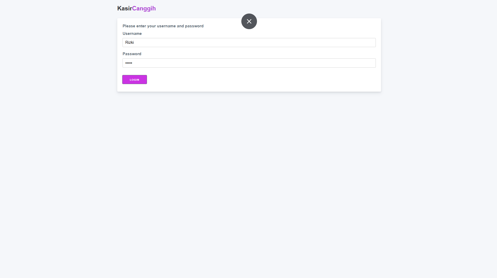
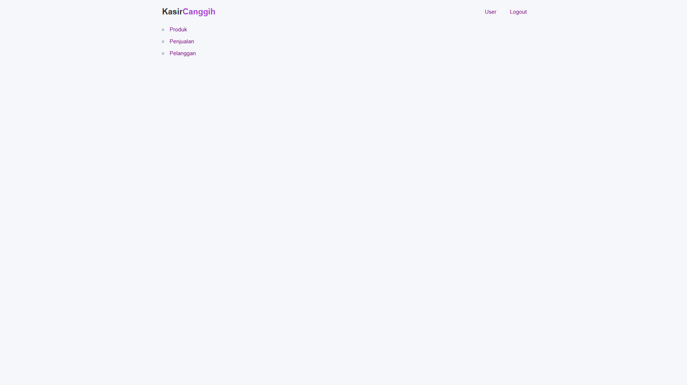
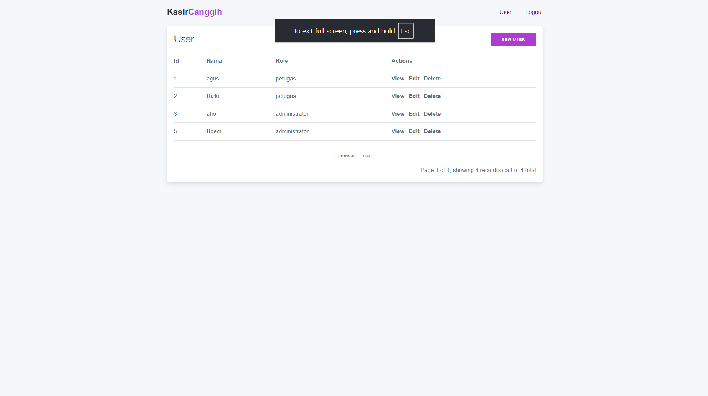
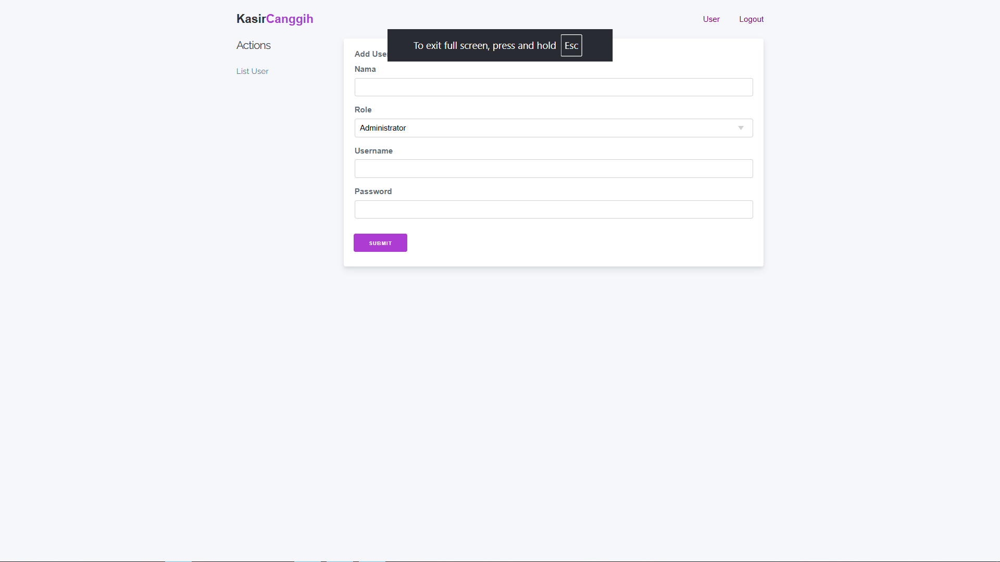
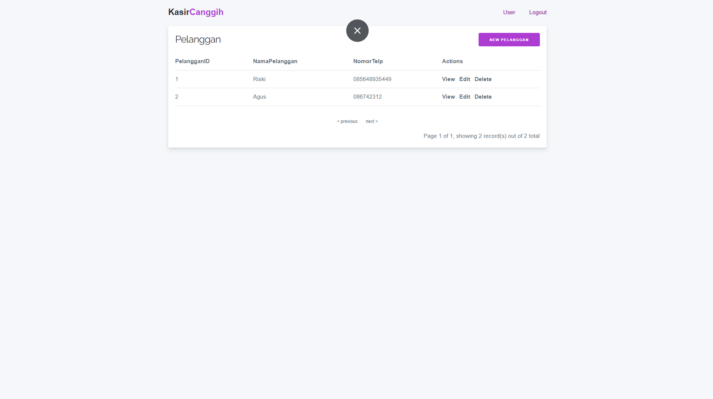
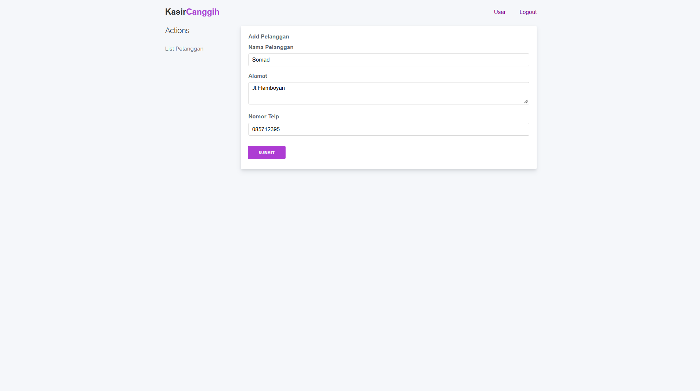
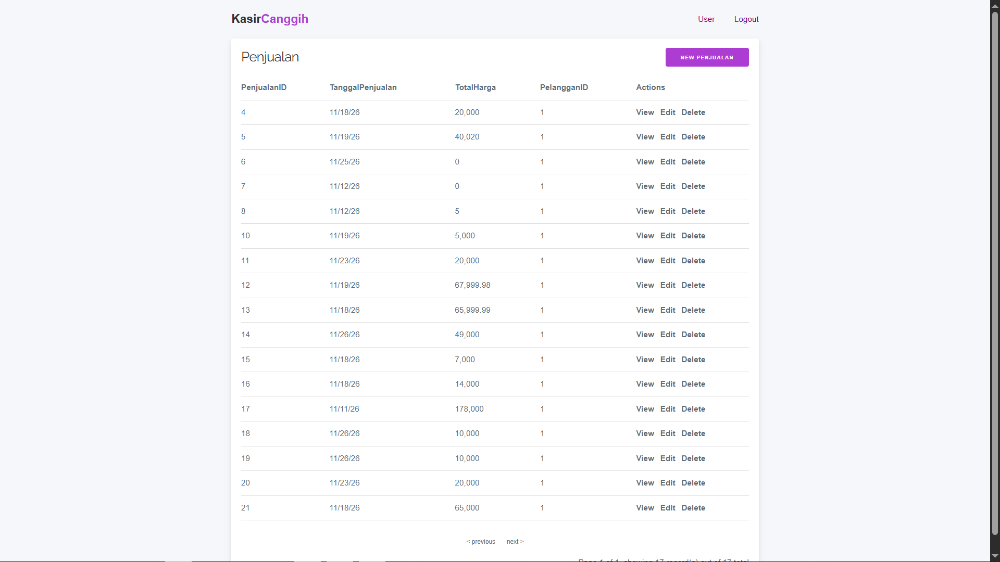
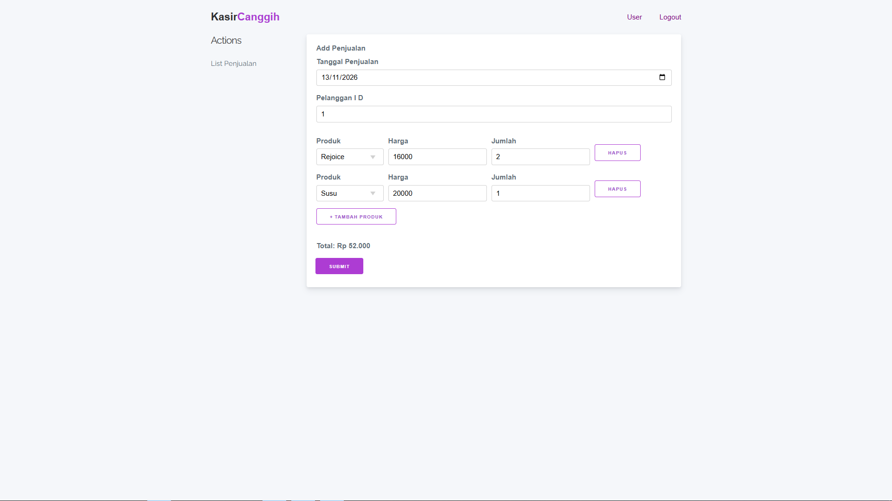
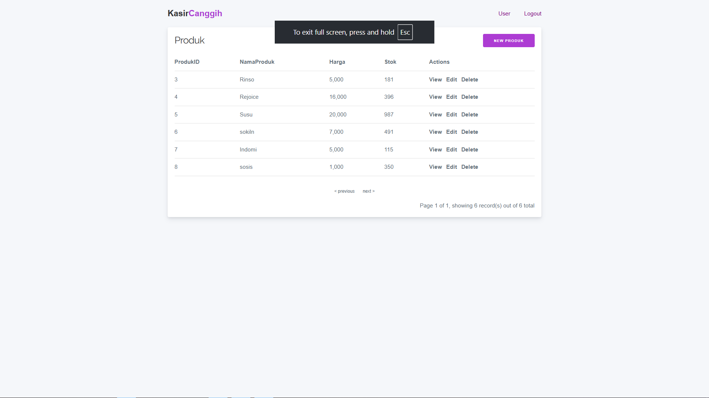
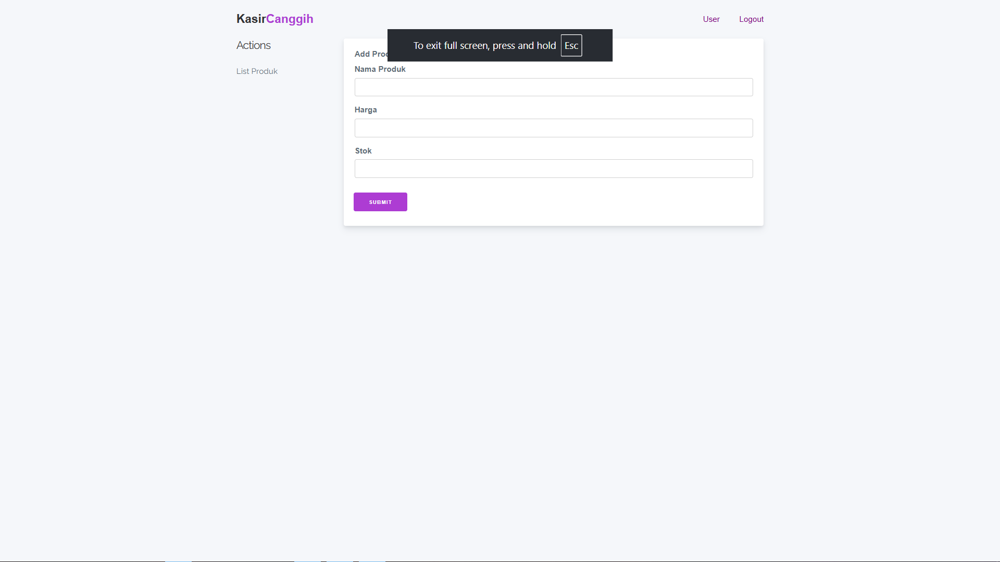

# KasirCanggih

Aplikasi kasir berbasis web untuk mengelola produk, pelanggan, dan transaksi penjualan. Dibuat dengan **CakePHP** dan **MySQL** sebagai tugas UKK.

## Fitur

**Autentikasi**
- Login dan logout
- Pembatasan akses berdasarkan role (administrator dan petugas)

**Manajemen Produk**
- Tambah, lihat, ubah, dan hapus data produk
- Pengelolaan harga dan stok barang

**Manajemen Pelanggan**
- Tambah, lihat, ubah, dan hapus data pelanggan

**Manajemen User**
- Kelola akun pengguna (khusus administrator)

**Transaksi Penjualan**
- Beberapa produk dalam satu nota
- Tombol tambah dan hapus baris produk
- Harga terisi otomatis saat produk dipilih
- Total dihitung otomatis
- Validasi stok sebelum transaksi disimpan
- Stok berkurang otomatis setelah penjualan

## Teknologi

- CakePHP 5.4
- PHP 8.2
- MySQL (XAMPP dan phpMyAdmin)
- Milligram CSS

## Akun untuk Mencoba

*Administrator*
- Username: `aho`
- Password: `54321`

*Petugas*
- Username: `Rizki`
- Password: `12345`

## Tampilan Aplikasi

*Login*

*Menu - Petugas*

*Menu - Admin*

*User*

*Pelanggan*

*Penjualan*

*Produk*

## Pembuat

Mokhammad Rizky - XI RPL 2 - SMKN 11 Malang